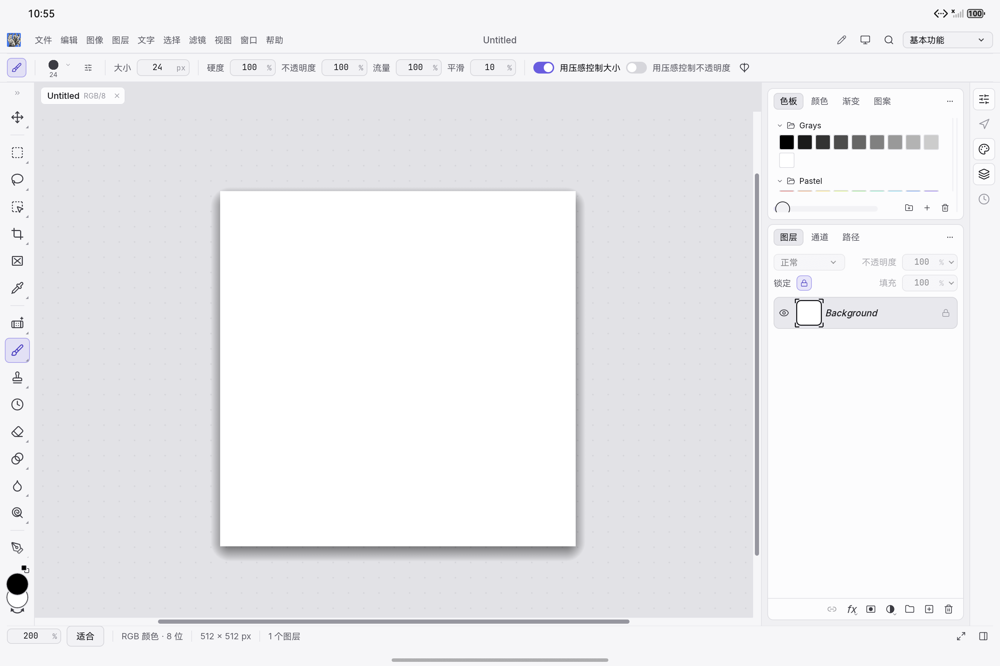
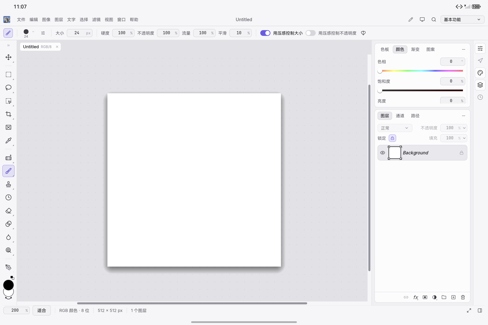

# HarmonyOS brush preview

The upstream tool cursor treats a non-Web root viewport as a desktop host that
uploads custom OS cursor images. The HarmonyOS host forwards stock cursor icons
only. A custom bitmap therefore does not provide a size-dependent brush tip on
the Pad; the upstream lifecycle can leave a stock crosshair as a fallback.

`tool_cursor::native` now excludes `target_env = "ohos"`. HarmonyOS uses the
existing canvas painter for brush circles, crosshairs and shaped tip outlines.
Desktop roots continue to upload cursor images. The painted backend preserves
cursor colours, dimensions and pen-hover opacity. ArkUI can hide its stock
pointer when egui reports `None`, because the tool cursor is now actually painted.

Native input tests accept either a painted circle or a visible cursor bitmap at
the current pointer position. Their leave/lift, stationary replay, resume, touch
suppression and document-revision assertions remain. The upstream pen-opacity
test now checks both outputs. Test-only calls were also updated for the existing
borrowed-shape and pen-gesture-context signatures, so the UI test crate compiles.

## Verification on 2026-10-13

- Before editing, both native rendered-brush-outline tests failed on their first
  visible-outline assertion.
- Native adapter unit suite: **57 passed**, including both previous failures.
- Tool cursor suite: **16 passed**, one visual-export test intentionally ignored.
  The pen hover/contact opacity test also passes.
- UI crate clippy with all targets and `-D warnings`: passed.
- Workspace layering: passed, 29 crates.
- Web application `cargo check --offline -p photocraft-web --target wasm32-unknown-unknown`:
  passed using the installed Rust 1.99 toolchain.
- ARM64 OHOS release library, default native HAP, independent simulator default
  and test HAPs, and native package verification: passed.

The complete UI unit suite is **2397 passed, 16 failed, 11 ignored**. It is not
fully green. Remaining failures are listed below; they were not changed in this
brush fix. The production cursor policy on the macOS test host is equivalent
before and after this change, but a separate complete pre-change suite was not run.

```text
brush_panel::tests::touch_group_drag_is_gated_and_move_group_reaches_its_target
canvas_menu_tests::control_channel_opening_uses_the_same_dismissal_guard
canvas_menu_tests::secondary_taps_keep_canvas_layer_menus_open
canvas_menu_tests::secondary_taps_keep_other_canvas_tool_menus_open
canvas_menu_tests::secondary_taps_keep_selection_menus_open
discard_ui::tests::quit_yes_waits_for_the_host_save_picker
i18n::live_tests::ukrainian_native_app_menu_keeps_product_and_language_names
i18n::tests::every_tl_literal_is_translated
new_doc_ui::tests::new_document_depth_labels_and_tooltips_are_translated
panels::color_tests::short_toolbar_scrolls_to_bottom_tools_without_moving_or_painting_canvas
prefs_ui::shortcut_capture_tests::ctrl_k_is_recorded_as_ctrl_k_not_the_control_key
prefs_ui::tests::preference_labels_are_translated
prefs_ui::tests::stylus_menu_and_tools_preferences_share_applied_and_persisted_values
status_bar_tests::status_bar_controls_sit_inside_the_bar_with_even_margins
swap_arrow::tests::rendered_glyph_has_a_left_head_and_a_lower_right_head
titlebar::tests::caption_buttons_take_the_right_end_and_nothing_overlaps_them
```

## Simulator pixels

Used the ARM64 `PhotoCraftPadAPI20` emulator at **2880 × 1920**, with independent
bundle `io.github.storytold.photocraft.brushpreviewtest`. The test-only runner
replays pen, mouse and touch input through the actual native worker and captures
the OHOS-rendered canvas. It does not reproduce physical M-Pencil firmware events.
No real Pad installation or relaunch was performed for this fix.

The before screenshots use the previously built debug-branch ARM64 library with
the same unfixed cursor policy. The after screenshots use this fix branch's newly
built OHOS library. The canvas fixture is 512 × 512, brush size 24, zoom 200%.
Pixels are compared in fixed 180 × 180 regions around the expected pointer, with
the emulator's 78-pixel app-window top inset included.

| Case | Before: changed canvas pixels | After: changed canvas pixels |
|---|---:|---:|
| Pen hover | 0 | 1220 |
| Movement after hover leave | 0 | 1220 |
| Movement after pen lift | 0 | 1220 |
| Mouse hover | 0 | 1267 |
| Leave, stationary replay after leave/lift, touch | 0 | 0 |

Both runs have document revisions **1 → 1 → 2 → 2**: hover leaves the document
unchanged, contact creates a stroke, and later hover/mouse/touch moves add no ink.
Visual inspection confirms the round tip, its disappearance on leave, the real
stroke, and the resumed tip beside that stroke.

Before:



After:


After leaving:



After a stroke, lift and resumed movement:


## Repeat the simulator test

Use a separate test checkout or local project copy. Change its app bundle,
build-profile capability and custom UTD namespace to the independent
`.brushpreviewtest` identity above; keep those local identity changes out of Git.
Build the native library and default HAP with `scripts/dev.sh build`, then build
the test module with:

```sh
hvigorw assembleHap --mode module -p module=entry@ohosTest -p product=default -p buildMode=debug --no-daemon
```

Install both unsigned HAPs on the emulator. The verifier requires Pillow, starts
a fresh test application process, and refuses a non-emulator or an ordinary app
bundle. Run from the test checkout:

```sh
python3 scripts/test_brush_preview_simulator.py --output-dir work/brush-preview/after
```

`--verify-existing` checks saved logs and screenshots without another test run.
`--phase before` expects missing painted previews from an unfixed library.
`--surface-offset-y` permits an explicitly measured window inset for another
emulator layout; the screenshot size still must be 2880 × 1920.

Local build logs are in `/private/tmp/photocraft-brush-*.log`; simulator logs,
test results and all ten captures are in ignored `work/brush-preview/{before,after}`.
