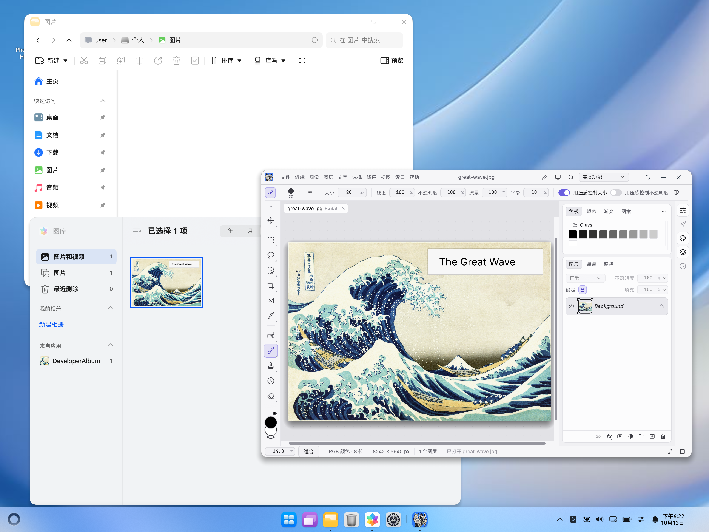

# Drag images into the native editor

The HarmonyOS editor XComponent accepts UDMF image, file-URI, legacy file and PixelMap records. `onDrop` disables automatic data prefetch (`disableDataPrefetch: true`) and starts `DragEvent.startDataLoading` while the event is valid, so the system can retrieve delayed or cross-application data and authorize/copy local files into a per-drop cache directory. The drag is a COPY operation; the source keeps its data.

`NativeDropAdapter` reads authorized `file://` URIs asynchronously, preserving the file name, or converts a supplied PixelMap to lossless PNG. Encoded image ArrayBuffer entries are also accepted. The page forwards the resulting names and bytes through the existing `native.open` bridge to PhotoCraft's importer. Each item opens as a document, matching File → Open; drop coordinates do not insert an image into an existing layer.

Duplicate URIs are skipped. One transfer runs at a time, with a maximum of 16 records and 256 MiB of combined encoded data. PixelMaps must additionally fit within a 256 MiB RGBA budget. Unsupported text/URLs are not fetched. Empty data, incomplete reads, oversize data and retrieval failures appear in the existing error panel. A failed batch is not partially queued to the importer. Importer format errors use its existing error reporting.

Temporary directories, file handles and the image packer are released after transfer/conversion. The receiver does not release the UDMF-owned PixelMap. Leaving the page cancels the system transfer; generation checks prevent late callbacks or reads from importing into a new page. Temporary file paths are never passed to Save. Editor focus is restored after a drop.

## Automated validation

```sh
node scripts/test_native_drop.cjs /path/to/typescript
scripts/dev.sh build
python3 scripts/verify_native.py entry/build/default/outputs/default/entry-default-unsigned.hap
```

The test executes the real adapter with mocked SDK services, covering modern/legacy URIs, partial reads, multiple/duplicate records, PixelMap PNG encoding, encoded bytes, aggregate limits, copy handoff, cancellation, concurrent drops, obsolete pages and cleanup on success/failure. The HAP build separately checks ArkTS against the installed SDK and links the ARM64 OHOS Rust library.

## Manual verification on 2in1

Use an emulator first. Keep PhotoCraft and Files/Gallery visible beside each other, then drag a local PNG or JPEG over the editor and release. Check that a new document appears with the correct dimensions and pixels. Repeat with multiple files and an image source supplying PixelMap data, if available. Confirm the source image remains in place and Save/Save As still uses the normal picker. Also try an unsupported item and cancelling a delayed transfer.

On 2026-10-13, the release ARM64 library and debug HAP built successfully; the unsigned package passed native verification. The new version was installed and launched on the `Huawei_2in1_Foldable` emulator (HarmonyOS 7.0/API 26, target `127.0.0.1:5557`). Native egui/wgpu initialization reached `ready`. The initial user test from Gallery reached onDrop but async loading failed with status 200. The missing `disableDataPrefetch: true` setting required by the SDK was then added with a regression check. The user's subsequent Gallery → PhotoCraft JPG drag succeeded. A device screenshot and import log confirm `great-wave.jpg` opened as an RGB/8 document, 8242 × 5640 px, with one Background layer. The source thumbnail remains visible in Gallery. Multi-file, PNG, PixelMap and Save/Save As manual checks remain unverified.


