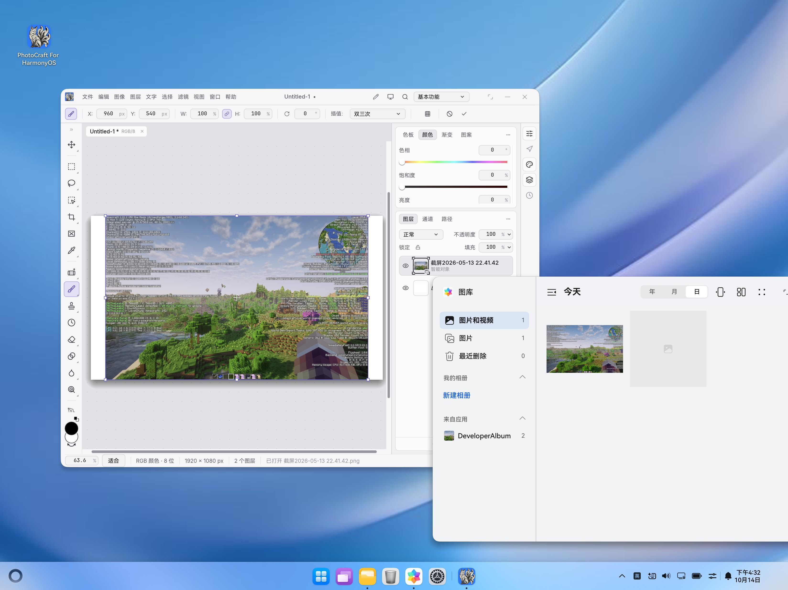
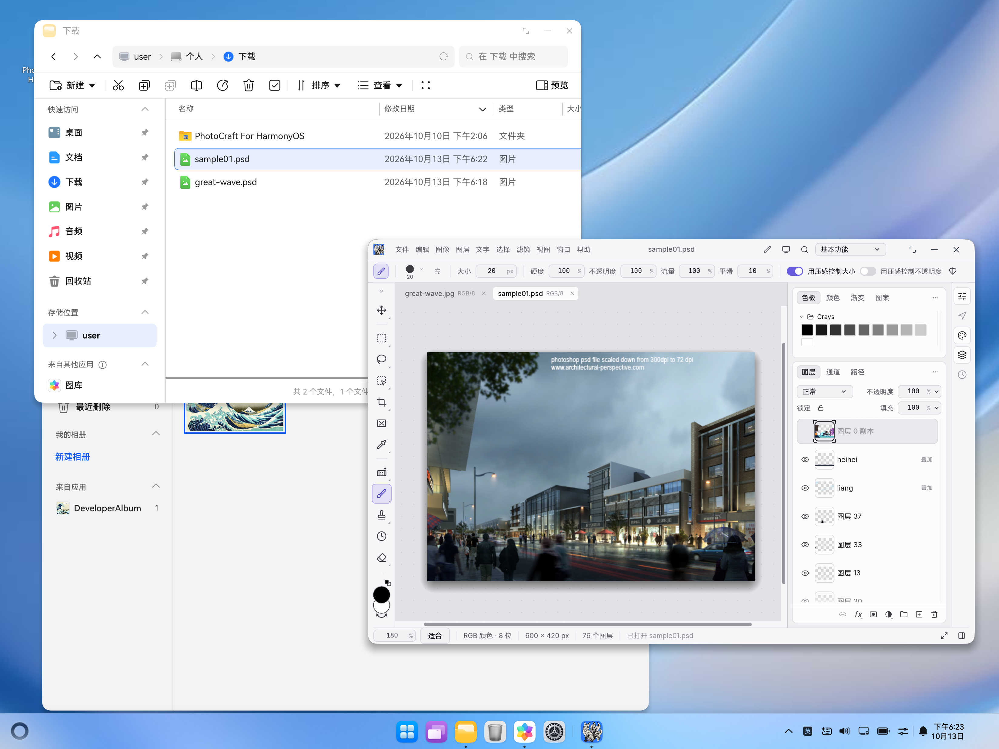

# Drag images into the native editor

The HarmonyOS editor XComponent accepts UDMF image, file-URI, legacy file and PixelMap records. `onDrop` disables automatic data prefetch (`disableDataPrefetch: true`) and starts `DragEvent.startDataLoading` while the event is valid, so the system can retrieve delayed or cross-application data and authorize/copy local files into a per-drop cache directory. The drag is a COPY operation; the source keeps its data.

`NativeDropAdapter` hands authorized `file://` URIs to the native bridge as duplicated file descriptors, preserving the file name without creating an ArkTS-sized whole-file buffer. It converts a supplied PixelMap to lossless PNG, and accepts encoded image ArrayBuffer entries when the source already supplied bytes. The final drop position is captured before asynchronous loading and forwarded with either `native.dropFile` or `native.drop`. Both use the editor's existing `open_dropped` routing and importer:

- Over the active canvas, the image is placed as a new layer in the current document and enters Free Transform. Enter confirms, Escape cancels, and the existing undo/redo history handles the whole placement. A PSD is placed as one layer (the existing embedded placement preference applies), rather than adding its internal layers to the current document.
- Over panels, toolbars, tabs or other areas, the image opens as a new document. When no document is open, the drop opens the image.

While dragging over the app, an ArkTS overlay highlights the target canvas only for layer placement. At the user’s request, it has no text, floating hint box or pointer dot; other-area opening has no visual hint. The overlay ignores hit testing, hides on leave/drop/page disposal, and rejects late or out-of-order native feedback. Native preview and final routing share the same editor hit test, including dialogs. Window-vp coordinates are converted to XComponent-local physical pixels and then to egui points, matching the configured display/zoom scale.

Duplicate URIs are skipped. One transfer runs at a time, with a maximum of 16 records. There is no fixed 256 MiB input limit: file descriptors are read by the native worker, while source-provided buffers and PixelMap packing use the platform's addressable memory and allocator checks. Unsupported text/URLs are not fetched. Empty data, invalid dimensions and retrieval failures appear in the existing error panel. A failed batch is not partially queued to the importer. Importer format errors use its existing error reporting.

Temporary directories, file handles and the image packer are released after transfer/conversion. The receiver does not release the UDMF-owned PixelMap. Leaving the page cancels the system transfer; generation checks prevent late callbacks or reads from importing into a new page. Temporary file paths are never passed to Save. Editor focus is restored after a drop.

## Automated validation

```sh
node scripts/test_native_drop.cjs /path/to/typescript
node scripts/test_drop_preview.cjs /path/to/typescript
cargo test --offline --manifest-path native/rust/Cargo.toml
scripts/dev.sh build
python3 scripts/verify_native.py entry/build/default/outputs/default/entry-default-unsigned.hap
```

The test executes the real adapter with mocked SDK services, covering modern/legacy URI descriptor handoff, duplicate records, PixelMap PNG encoding, encoded bytes above 256 MiB, copy handoff, cancellation, concurrent drops, obsolete pages and cleanup on success/failure. The preview test covers coordinate offsets, display scaling, action changes, stale replies and transparent hit testing. Native tests run the real importer/editor to check canvas placement, other-area opening, PNG/PSD import, transform commit/cancel, one-step undo/redo, multiple drops and invalid input. The HAP build separately checks ArkTS against the installed SDK and links the ARM64 OHOS Rust library.

2026-10-14 validation on the synced branch:

- All 72 native adapter tests passed, including six new real-editor drop tests. Adapter, preview and large-file handoff Node tests passed.
- Release ARM64 OHOS build, debug HAP compilation, native package verification, architecture layering (29 crates) and `cargo xtask wasm` passed.
- Upstream default UI suite: 2400 passed, 14 failed, 11 ignored. A separate temporary copy of unmodified main reproduced exactly the same 14 failures; existing canvas-drop/file-open tests passed. With `harmonyos-ui`, 15 UI tests failed (the additional failure is a desktop-only menu expectation).
- Upstream Clippy with `-D warnings` was blocked by existing `chunks_exact_mut`/`chunks_exact` calls in `tool_cursor.rs:387` and `input_tests.rs:983` under the installed Rust toolchain. These files are unchanged in this PR.
- Final HAP without drag text, hint box or pointer dot installed on `127.0.0.1:5557`; native GPU initialization reached `ready`. SHA-256: `f9a9e794ac6b038cbacd08a93dd3135833d24bdbaa6f3242a20b6e5d03b1afc8`.

## Manual verification on 2in1

Keep PhotoCraft and Files/Gallery visible beside each other on the 2in1:

1. Open a document, then hold a JPG over the canvas. Verify the canvas highlight without a floating hint or pointer dot.
2. Move the same drag to a panel or toolbar. Verify the canvas highlight disappears. Move back to the canvas and release: the document/tab count should stay the same and one new layer should enter Free Transform.
3. Confirm placement with Enter, then undo/redo; repeat and cancel with Escape.
4. Drop a JPG or PSD over a panel: a new document should open, preserving the PSD's internal layers. Drop a PSD over the canvas: it should be placed as one layer.
5. Leave the app or cancel a drag: the overlay should disappear. With no document, a drop should open the image.
6. Confirm the source remains intact and Save/Save As still uses the normal picker. Multiple files, PixelMaps and delayed/cancelled transfers can be checked separately.

On 2026-10-14 the user successfully dragged `截屏2026-05-13 22.41.42.png` from Gallery onto an existing canvas. The 3296 × 2472 device screenshot below shows one `Untitled-1` RGB/8 document at 1920 × 1080 px, two layers, the imported layer labelled **智能对象**, and active Free Transform handles. The source thumbnail remains in Gallery. This manual check used the first placement build, before syncing the later GPU/file-descriptor changes from main. Canvas-highlight switching and the synced build's descriptor path remain for the user to check. The screenshot captures an unsaved document; the user subsequently authorized discarding it before installing the synced build.



The screenshots below record the earlier open-only version.

On 2026-10-13, the release ARM64 library and debug HAP built successfully; the unsigned package passed native verification. The new version was installed and launched on the `Huawei_2in1_Foldable` emulator (HarmonyOS 7.0/API 26, target `127.0.0.1:5557`). Native egui/wgpu initialization reached `ready`. The initial user test from Gallery reached onDrop but async loading failed with status 200. The missing `disableDataPrefetch: true` setting required by the SDK was then added with a regression check. The user's subsequent Gallery → PhotoCraft JPG drag succeeded. A device screenshot and import log confirm `great-wave.jpg` opened as an RGB/8 document, 8242 × 5640 px, with one Background layer. The source thumbnail remains visible in Gallery. The user also successfully dragged `sample01.psd` from Files. Its screenshot confirms an RGB/8 document, 600 × 420 px, with 76 layers; the original JPG remains in another tab. The corresponding drop-queue log confirms the PSD used this new import path. Multi-file batches, PNG, PixelMap and Save/Save As manual checks remain unverified.



