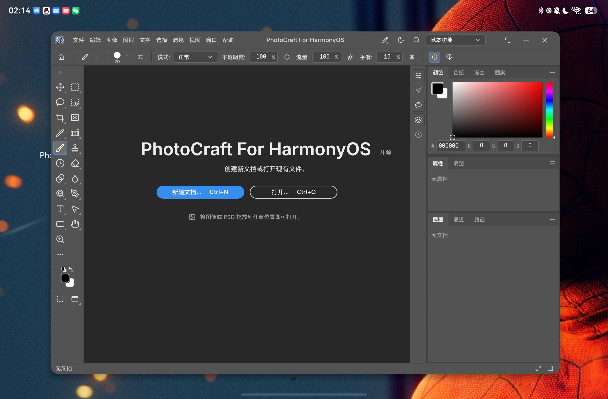
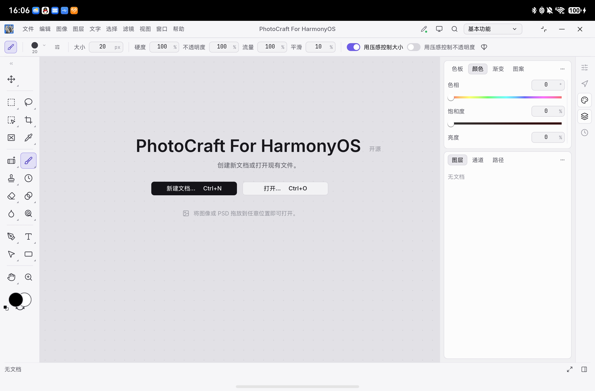
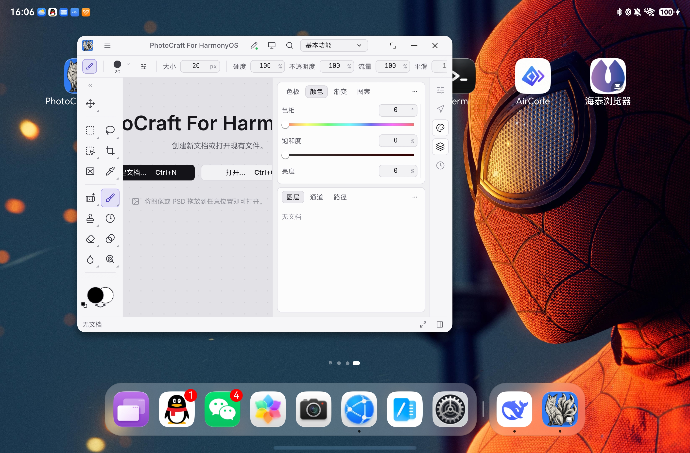

# Integrated title-bar geometry recovery

2026-10-10: fixed loss of caption-button clearance during window transitions.

The host previously cleared its inset on a failed query or a zero rectangle, and rejected valid rectangles unless the window status was floating/maximized. Status and geometry can update independently. The host now accepts valid caption rectangles regardless of a lagging status, retains its last valid inset during floating/maximized zero-geometry transitions and query failures, and refreshes at 50/200/600/1200 ms after status/size/foreground changes. Timers and listeners are removed at window-stage destruction.

The native ready notification resends current geometry. Rust retains physical geometry and converts it each frame using the current egui zoom factor.

2026-10-11: fixed missing clearance when the app starts outside freeform and later enters it.

`setWindowDecorHeight` / `setWindowDecorVisible` / `setWindowTitleMoveEnabled` often throw outside free multi-window (abnormal window state). Those calls used to sit in the same `try` as listener registration, so a fullscreen start could leave `WindowChrome` with no status/size/rect listeners. Entering freeform later never refreshed `photocraftTitleRight`, and the native caption buttons covered the top-bar controls.

Decor setup is now best-effort and separate from listening. Status and size changes re-apply decor before refreshing geometry, so a runtime freeform entry recovers the inset even when startup decor failed.

2026-10-11 (compile fix): PR #4 briefly typed the shared layout callback as `WindowStatusType` and reused it for `windowSizeChange`. ArkTS overload resolution then rejected `on/off('windowSizeChange', …)` (error mentioning `freeWindowModeChange`). Status and size now use separate callbacks (`Callback<WindowStatusType>` vs `Callback<Size>`) that both re-apply decor and refresh geometry.

Validation:

- `scripts/test_window_chrome.cjs`: passed mocked transition-zero, query-error, delayed-recovery, visible-caption/lagging-status, non-floating empty geometry, lifecycle cleanup, and freeform-entry-after-fullscreen (decor-throw and size-driven) regressions.
- Dual-target Rust release build and signed HAP build passed; `verify_native.py` passed (2026-10-10 validation).
- Installed on real device `3GLUN25314G05064` after confirming the app had no open documents (2026-10-10).
- Floating-window and restored foreground large-window screenshots show workspace/stylus controls clear of the native caption buttons. Device log reports a 139×37 vp caption rectangle and 147 vp reserved width.
- The 2026-10-10 maximize-button attempt returned to the desktop; that attempt alone did not establish a complete maximize/recover interaction test. See the later user validation below.
- 2026-10-11 freeform-entry fix: CLI unit tests passed; device validation was initially deferred to the user.

## Real-device validation, 2026-10-14

- The user confirmed that freeform mode works on their Pad. A captured 2800×1840 frame shows the desktop behind PhotoCraft, native caption buttons, and the resize affordance. `WindowManagerService` reported `photocraft0` at `[234,145,2345,1579]`, visible and focusable, with `DecoStatus: true`.
- The user also tested maximization and window resizing successfully, and supplied the two screenshots below, taken at 16:06:27 and 16:06:36 (Asia/Shanghai). This closes the earlier pending manual acceptance for maximization and resizing. These are user-run tests; the screenshots document their resulting states rather than an automated transition sequence.
- The maximized view renders the editor across the available display area. The smaller floating view renders within the new window bounds and keeps native caption buttons clear of workspace controls. The smaller view also shows clipping of the large start-page heading and the wide brush toolbar; this layout limitation remains visible in the evidence and is not a GPU recovery failure.
- Repeated transition stress testing and fault injection during a resize are not established by these screenshots.

### Captured floating window

### User-tested maximized window

### User-tested resized floating window

Local evidence (not committed): `work/titlebar-recovery-after.jpeg`, `work/titlebar-recovery-restored.jpeg`, `work/titlebar-recovery-hilog.log`, `work/titlebar-recovery-build.log`.
