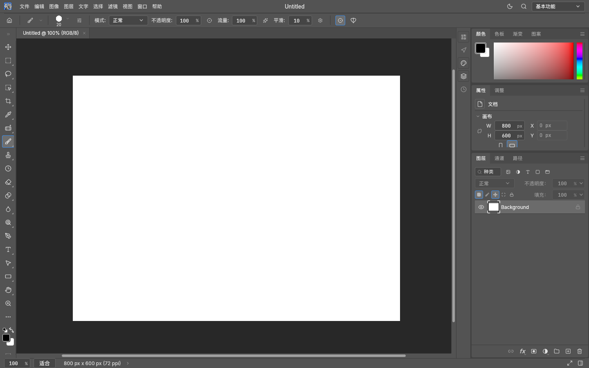
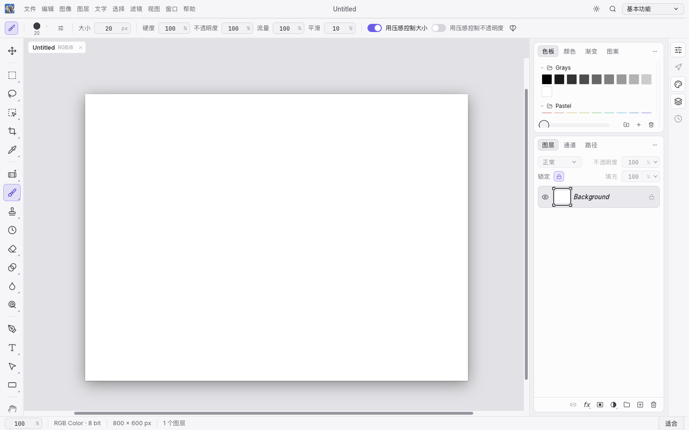
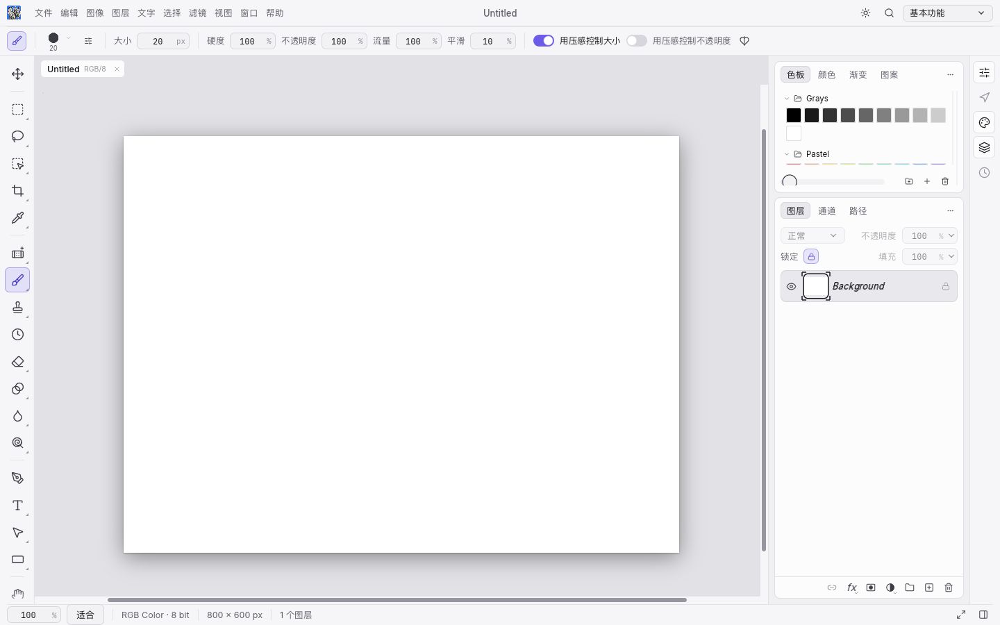
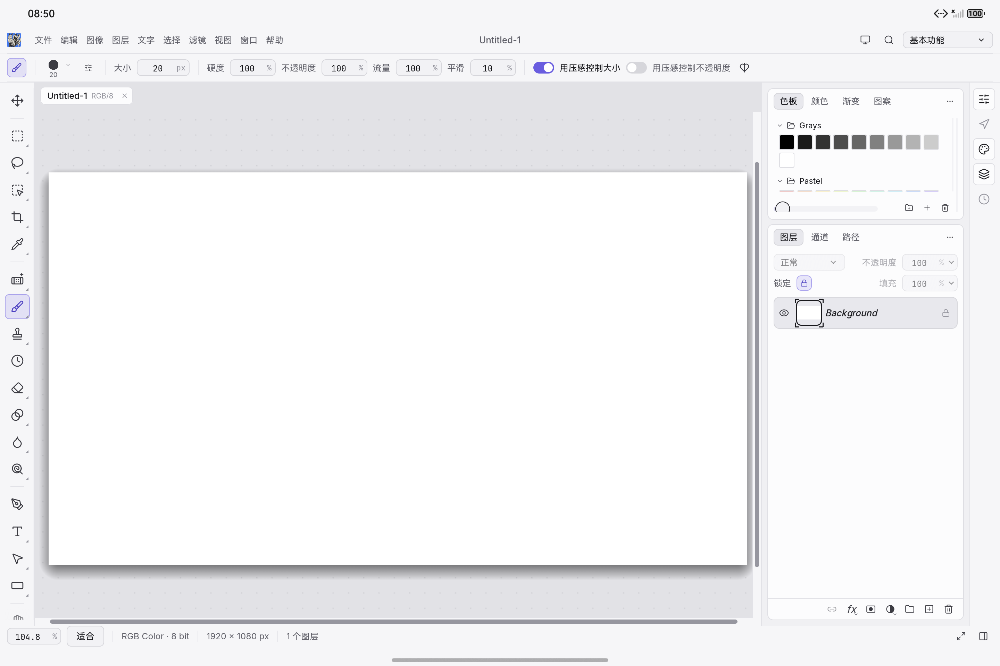

# Status bar touch controls

The status bar exposes the existing Tab and Shift+Tab actions through the embedded Lucide `maximize-2` and `panel-right` SVGs. The left icon hides/restores the toolbar, options bar and dock using `window.togglePanels`; the right icon toggles only the dock using `window.toggle.dock`. Both remain accessible after panels are hidden. Their icon, tooltip and appearance stay fixed, without a selected-state indicator.

The controls use 14-point glyphs and 22-point Pro / 28-point other hit targets. The status bar retains its 24-point Pro / 30-point other height. Status text is clipped before the reserved right-hand controls; background job progress and cancellation remain next to them.

Fit now sits immediately after the zoom percentage in every theme. Non-Pro themes reuse the original secondary button, including its 13-point medium text, 28-point horizontal padding and 30-point height. Pro uses the same text size and horizontal padding in its existing 24-point status bar. The divider is drawn inside the bar so a full-height Fit button does not enlarge it.

## Verification

Verified on 2026-10-11 with the `harmonyos-ui` feature and configured Rust 1.99.0 toolchain.

| Check | Result |
| --- | --- |
| Five new status control UI tests | Passed |
| All 10 themes, 360 / 1400-point windows, long status, with / without a document | Original status height and anchored icons preserved |
| Fit in all 10 themes | Original text size / padding retained; immediately right of zoom; click requests document fit |
| Mixed hidden panel combinations, existing shell commands | Passed |
| Touch events in the full shell with finger painting blocked | Passed; document history unchanged |
| Full UI test suite | 1842 passed, 4 existing failures, 10 ignored |
| UI Clippy, all targets, warnings denied | Passed |
| Dependency layers | Passed, 29 crates |
| WASM compatibility | Passed |
| ARM64 native library / HAP build / native package verification | Passed |
| HarmonyOS ARM64 simulator touch checks | Both panel toggles hide and restore correctly; Fit restores viewport fit after selecting 100% |

The same four full-suite failures reproduce on unchanged main (`227ea9d7`):

- `discard_ui::tests::quit_yes_waits_for_the_host_save_picker`
- `input_tests::hand_tool_shows_an_open_hand_and_a_fist_while_panning`
- `native_host_tests::host_local_save_and_external_save_as_use_separate_destinations`
- `panels::color_tests::short_toolbar_scrolls_to_bottom_tools_without_moving_or_painting_canvas`

The baseline suite had 1837 passing tests, those same four failures and 10 ignored tests. This change adds five passing tests.

Simulator checks use the isolated `io.github.storytold.photocraft.panelcontroltest` bundle on `127.0.0.1:5555`. The regular app and real Pad are unaffected. The temporary test bundle name is restored in source after packaging. Test documents are blank generated canvases.

## Screenshots

Offscreen comparisons use the same 1440 × 900 viewport, scale 1, blank 800 × 600 canvas and `harmonyos-ui` feature. Baseline captures use unchanged main UI source.

| Theme | Before | After |
| --- | --- | --- |
| Pro Medium |  |  |
| Studio Light |  |  |

The final 2880 × 1920 simulator capture shows Fit next to zoom and compact, neutral panel icons at the lower right:

