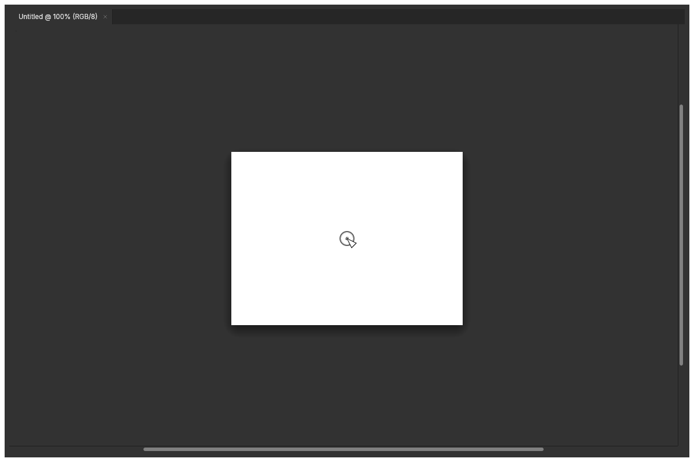

# HarmonyOS touchscreen navigation

The native host backports the shared canvas input changes from
[PhotoCraft PR #3957](https://github.com/storytold/photocraft/pull/3957), reviewed at
`31cde127e3d4cec5d93530bfa4ed17aa96ed1c69`.

A first finger starts a provisional brush stroke immediately. While that finger
stays within two logical points of its origin, a second finger can take over
navigation and discard the provisional stroke. Moving the first finger starts a
50 ms grace period. Once the period ends, a second finger commits the received
stroke before switching to pan/pinch navigation. Joining and lifting fingers do
not replay compatibility-pointer movement into the canvas transform.

The native adapter no longer adds its own 50 ms / six-point Primary delay.
It still suppresses remaining fingers after multi-touch, guards briefly against
platform contact replays, and gives the pen priority over palm contacts.
Preferences > Tools > Block finger input continues to make a lone finger pan.
Multi-touch navigation hides tool cursors; Hand dragging keeps its fist cursor.
Wheel/trackpad navigation preserves an existing mouse or pen stroke and blocks
new compatibility presses through release.

This is a native-host backport, not an upstream subtree release sync. The PR's
browser listeners and web packaging changes are not needed by the HarmonyOS
host. The imported upstream history and native-only HAP workflow are preserved.

Regression coverage lives in the shared `input_tests` / `touch_nav` tests and
`native/rust/tests/unit/input.rs`. The native test sends HarmonyOS contact
snapshots through the adapter and real host UI with a fixed 1200 × 800 viewport,
checking both provisional cancellation and exactly-once owned-stroke commit.

## Verification (2026-10-13)

- Native adapter unit tests: 63 passed.
- Shared canvas input tests: 41 passed; navigation screenshot test also passed with GPU access.
- Clippy (`photocraft-ui-egui --all-targets -D warnings`), formatting and dependency layering passed.
- `cargo xtask wasm` passed using the installed rustup toolchain (Homebrew Rust lacks the wasm target).
- ARM64 OHOS release library, debug native HAP and `verify_native.py` passed.
- Full UI unit suite in the local working tree: 1884 passed, 10 ignored, 3 failed:
  `discard_ui::tests::quit_yes_waits_for_the_host_save_picker`,
  `panels::color_tests::short_toolbar_scrolls_to_bottom_tools_without_moving_or_painting_canvas`,
  `titlebar::tests::caption_buttons_take_the_right_end_and_nothing_overlaps_them`.
  The working tree also contains separate uncommitted host/UI changes; those are not included in this backport.
- No simulator was connected. Physical-device gesture verification remains pending.

The same 1200 × 800 harness frame before and after multi-touch acquisition keeps
its canvas position and removes the painted brush tip. The arrow in these images
is the test harness's synthetic pointer, independent of the platform cursor output
(which is asserted to be `None`).

| Hover | Two-finger navigation |
| --- | --- |
|  |  |
